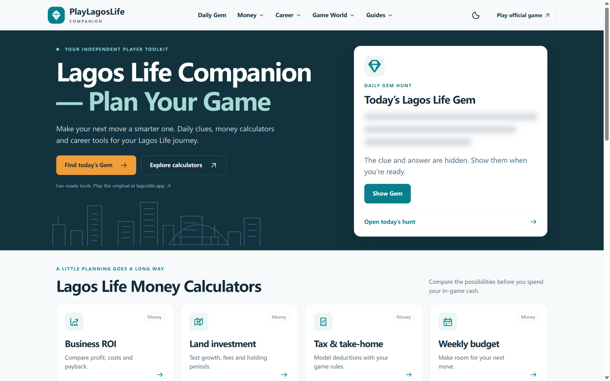

# PlayLagosLife Companion — Plan Your Game, One Tool at a Time

**Website: [https://playlagoslife.app/](https://playlagoslife.app/)**

*Screenshot: the [PlayLagosLife](https://playlagoslife.app/) homepage, with today's Daily Gem hunt and the money calculator grid above the fold.*

---

## What Is Lagos Life?

Lagos Life is a life-simulation game set in a vibrant, Nigeria-inspired world. You create a character, start at the bottom, and build your life story decision by decision: chasing promotions at work, launching a business, investing in land and property, renting (or eventually buying) a home, and managing a weekly budget while you navigate the city. The official game lives at [lagoslife.app](https://lagoslife.app/).

Like most life sims, the tricky part is not playing — it is playing *well*. Which business actually pays back? Is that plot of land worth the fees? How much of your salary survives tax? That is exactly the gap [PlayLagosLife](https://playlagoslife.app/) (https://playlagoslife.app/) fills.

## What Is PlayLagosLife?

[PlayLagosLife](https://playlagoslife.app/) is an independent, fan-made companion site for Lagos Life players. It is not part of the official game — it sits alongside it, offering free browser-based tools, spoiler-safe puzzle hints, and plain-English guides that help you plan smarter in-game decisions instead of guessing.

## What You'll Find on the Site

### 1. Daily Gem Hints

The Daily Gem is a daily puzzle players hunt for in-game, and the site's [Daily Gem page](https://playlagoslife.app/daily-gem) helps without spoiling. Instead of giving the answer away, it uses a spoiler-safe hint system — a starting letter here, a category there — that you reveal one clue at a time. You get the nudge you need and still keep the "aha" moment.

### 2. Money & Investment Calculators

The heart of the site. Each calculator models a real in-game decision:

- [Business ROI Calculator](https://playlagoslife.app/business-calculator) — compare profit, costs, and payback periods before you commit to a business.
- [Land Investment Calculator](https://playlagoslife.app/land-calculator) — test growth, fees, and holding periods on land deals.
- [Tax Calculator](https://playlagoslife.app/tax-calculator) — model deductions and see your true take-home pay.
- [Weekly Budget Calculator](https://playlagoslife.app/weekly-budget-calculator) — make room for your next big move.
- [Rent Calculator](https://playlagoslife.app/rent-calculator) — figure out what rent you can actually afford.

Backed by reference databases such as the [Business Database](https://playlagoslife.app/businesses), [Land and Property Investments](https://playlagoslife.app/land), and [Houses and Rent](https://playlagoslife.app/houses).

### 3. Career Planning Tools

- [Jobs and Salaries](https://playlagoslife.app/jobs) — see what each career path really pays.
- [Promotion Planner](https://playlagoslife.app/promotion-planner) — map your route up the ladder.
- [Skill Training Calculator](https://playlagoslife.app/skill-calculator) — plan skill training, plus the [Skills and Training](https://playlagoslife.app/skills) reference.

### 4. City Navigation & Timing

- [Game Clock](https://playlagoslife.app/game-clock) — keep track of in-game time.
- [Governor and Election Tracker](https://playlagoslife.app/governor) — follow the political cycle.
- [Locations](https://playlagoslife.app/locations) and [Transport Options](https://playlagoslife.app/transport) — know the city.
- [Travel and Route Planner](https://playlagoslife.app/route-planner) — get around efficiently.

### 5. Guides, Updates & FAQ

New-player friendly write-ups like [How to Play Lagos Life](https://playlagoslife.app/how-to-play), [How to Play Online](https://playlagoslife.app/download), the [Money Guide](https://playlagoslife.app/money), and the [Housing Guide](https://playlagoslife.app/houses) explain the systems behind the numbers. A [data updates page](https://playlagoslife.app/updates) tracks every change as the game evolves, and the [Companion FAQ](https://playlagoslife.app/faq) answers common questions.

## Why It Stands Out

- **Spoiler-safe by design** — hints nudge you toward the Daily Gem answer without ruining it.
- **Decision-first, not data-dump** — calculators turn raw game data into "should I do this?" answers.
- **Kept current** — data changes are logged transparently on the updates page.
- **Free and browser-based** — no downloads or accounts, just open and plan.

## Quick Links

| Resource | Link |
| --- | --- |
| Homepage | [https://playlagoslife.app/](https://playlagoslife.app/) |
| Daily Gem | [https://playlagoslife.app/daily-gem](https://playlagoslife.app/daily-gem) |
| Business ROI Calculator | [https://playlagoslife.app/business-calculator](https://playlagoslife.app/business-calculator) |
| Promotion Planner | [https://playlagoslife.app/promotion-planner](https://playlagoslife.app/promotion-planner) |
| How to Play Guide | [https://playlagoslife.app/how-to-play](https://playlagoslife.app/how-to-play) |
| Official Game | [https://lagoslife.app/](https://lagoslife.app/) |

## Disclaimer

This repository is an independent introduction to the site. [PlayLagosLife](https://playlagoslife.app/) is a fan-made companion project and is not affiliated with or endorsed by the developers of the official Lagos Life game at [lagoslife.app](https://lagoslife.app/). All game names and trademarks belong to their respective owners.
